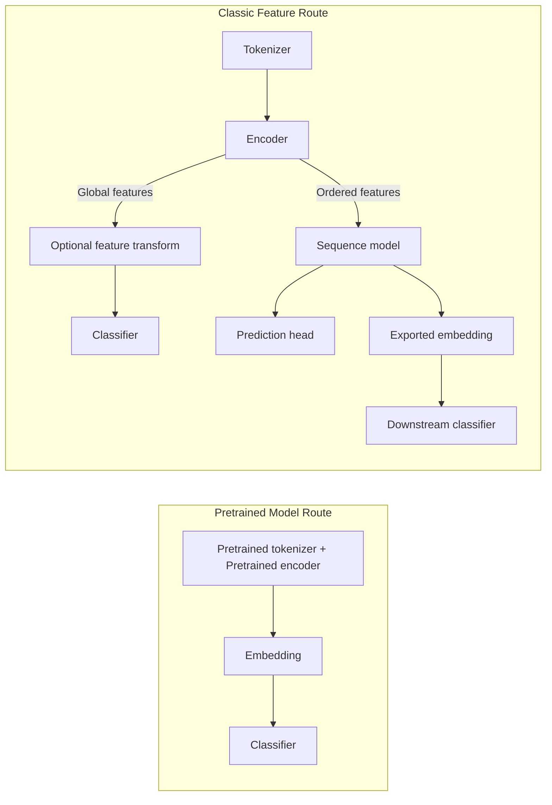

# Overview

PepPlatform is a unified machine learning platform for peptide prediction. It integrates data processing, sequence representation, model training, independent testing and analysis, experiment management, model reuse and inference into a single workflow. The platform offers both a **Web** interface for visual experiment management and a **CLI** for batch training scripts.

Supported classification tasks are organized into three input settings — peptide-only, peptide–target sequence, and peptide–HLA allele — and implemented through four task interfaces.

| Input setting | Task interfaces | Prediction target |
| --- | --- | --- |
| Peptide-only | `pep_function` | Therapeutic peptide function (binary or multilabel) |
| Peptide–target sequence | `pep_protein_interaction` | Peptide–protein interaction (binary) |
| Peptide–HLA allele | `pep_hlai`, `pep_hlaii` | HLA-I / HLA-II ligand presentation (binary) |

## Modeling Dimensions

Modeling choices are organized along three complementary dimensions borrowed from linguistics. They are a heuristic for navigating configurable options, not a fixed pipeline:

- **Syntax** — sequence tokenization and encoding, spanning classical encodings and pretrained protein representations. See [Tokenizers](./tokenizers) and [Encoders](./encoders).
- **Semantics** — optional relation-guided supervision that encourages differentiable representations to reflect the label-similarity structure of the training data. See [Semantic Loss](./semantic-loss).
- **Pragmatics** — the prediction setting and input organization, distinguishing peptide-only input from modeling conditioned on a target protein or an HLA allele. See [Pair Interaction](./pair-interaction).

## Core Capabilities

| Dimension | Content |
| --- | --- |
| Task types | Four task interfaces: peptide function, peptide–protein interaction, HLA-I and HLA-II ligand presentation |
| Feature routes | Pretrained-model route, classic-feature route |
| Interfaces | Web visual wizard + CLI training scripts |
| Model scope | Sequence models (CNN/RNN/GRU/LSTM/Transformer), classical classifiers, graph predictors |

See [Task Types](./tasks) and [Feature Routes](./routes).

## Key Terminology

Understanding the following terms helps grasp the platform's design philosophy:

- **Encoder**: The broad term used by the platform for converting tokenized sequences into numeric inputs. It intentionally includes both classical encodings such as BoW and learned or semantically meaningful inputs such as static embeddings.
- **Representation**: Reserved for vectors whose geometry carries useful semantics. Not every encoder output is a representation: index IDs, one-hot vectors, and BoW vectors are valid encodings without necessarily defining a semantic space.
- **Sequence-preserving encoders**: Keep ordered per-position structure, so their outputs can be modeled by CNN, GRU, LSTM, or Transformer sequence models.
- **Global encoders**: Collapse a sequence into one vector and are consumed directly by downstream classifiers, optionally after a feature transformation.

::: tip Encoder vs Representation
"Encoder" is the platform's umbrella term for all numeric conversion methods; "Representation" refers specifically to vectors with semantic geometry. Whether an encoder output constitutes a representation depends on its semantic properties, not whether it is called an embedding.
:::

See [Encoders](./encoders).

## High-Level Workflow

The platform has two feature-extraction entry points, corresponding to the pretrained-model route and the classic-feature route:



Text representation:

```text
pretrained model
  pretrained tokenizer + frozen encoder -> pooled embedding -> classifier
                                  or -> residue features -> adapter + backbone -> head/export

classic pipeline
  tokenizer -> encoder
               |- global features -> optional feature transformation -> classifier
               `- ordered features -> sequence model -> prediction head
                                             or
                                        exported embedding -> downstream classifier
```

Pretrained models remain a separate path because they already bundle tokenization and encoding into one coherent feature extractor.

::: info Paper-level Shorthand
For concise paper-level descriptions, `tokenizer -> encoder -> classifier` remains a valid shorthand for the classic global-feature path. A full system description should mention the sequence-model branch and the pretrained-model branch explicitly.
:::

## Guided Flow

All user-facing wizard prompts are in English. The guided steps for each route are described in [Feature Routes](./routes); the guided steps for pair tasks are described in [Pair Interaction](./pair-interaction).

## Compatibility Notes

- The documented legacy `--model` aliases remain accepted; removed or incompatible routes still fail validation.
- Legacy `--model cnn|rnn|gru|lstm|transformer` commands map to `sequence_model=<model>`, `training_mode=end_to_end`, and `classifier=mlp`.
- New role-level settings expose the clearer model structure through `--sequence_model`, `--training_mode`, and `--classifier`.
- Pair tasks expose their structure through `--pair_strategy`, `--interaction_level`, `--interaction_model`, `--predictor_type`, and `--graph_predictor`.
- Legacy pair aliases remain accepted: `--ppi_interaction_mode`, `--hlaii_interaction_mode`, and pair-task `--model` values such as `cross_attn+mlp`, `bi_cross_attn+mlp`, or graph-model names are normalized into the explicit role-level fields.
