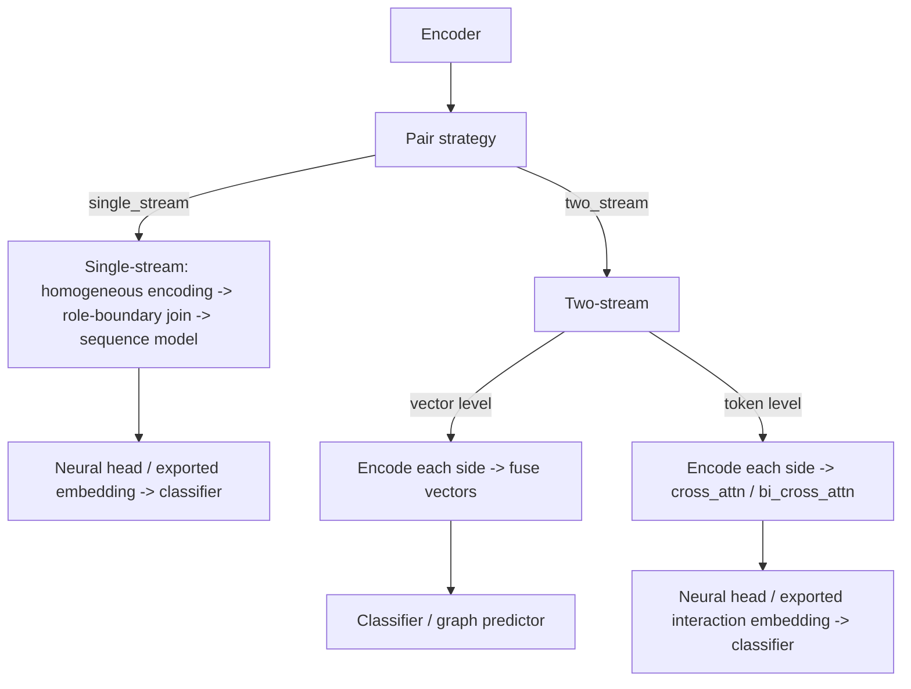

# Pair Interaction

Pair interaction tasks (peptide–protein, peptide–HLA-I, peptide–HLA-II) add an explicit layer between the encoder and the final predictor to model the interaction between two sequences.


Stream describes downstream pair-input organization, independently of upstream encoder count or weight sharing. **Single-stream** joins position-wise inputs with an explicit role boundary before a **joint modeling backbone**. For pretrained routes, each side is encoded independently before residue representations are joined. **Two-stream** retains the two role-specific inputs until vector-level fusion or token-level cross-interaction; it can then form one joint representation. HGT retains typed role nodes through graph modeling and predicts pair edges. Peptide-only tasks are outside this classification.

CLI/API use `single_stream` / `two_stream` (also `single-stream` / `two-stream`). Legacy `single_tower` / `dual_tower` remain accepted on input and are normalized to the current stream names. Frozen artifacts retain their recorded identifiers and are read through compatibility adapters without rewriting the originals. Encoder sharing and homogeneous/heterogeneous settings are separate properties.

## Workflow Overview



Text representation:

```text
encoder
  -> pair strategy
       |- single_stream
       |    use matching peptide/partner representation settings
       |    -> compact valid positions + explicit role boundary + right padding
       |    -> sequence model
       |    -> neural head or exported embedding -> classifier
       |
       `- two_stream
            |- vector-level interaction
            |    encode each side separately -> fuse vectors
            |    -> classifier or sample-graph predictor
            |
            `- token-level interaction
                 encode each side separately -> cross_attn / bi_cross_attn
                 -> neural head or exported interaction embedding -> classifier
```

## Pair Strategy

The pair strategy (`--pair_strategy`) determines how the two sequences are organized:

| Strategy | Description |
| --- | --- |
| `single_stream` | Use one homogeneous encoder contract, add an explicit role boundary to the compact pair sequence, then model it with one sequence model |
| `two_stream` | Encode each side separately and fuse at the vector or token level |

## Interaction Level

Only the `two_stream` strategy requires selecting an interaction level (`--interaction_level`):

| Level | Description | Interaction model |
| --- | --- | --- |
| `vector` | Vector-level interaction; fuse the two vectors then pass to a predictor | — |
| `token` | Token-level interaction; use cross-attention to model token relationships across sides | `cross_attn` / `bi_cross_attn` |

### Interaction Models

Token-level interaction offers two interaction models (`--interaction_model`):

| Model | Description |
| --- | --- |
| `cross_attn` | Unidirectional cross-attention |
| `bi_cross_attn` | Bidirectional cross-attention; each side serves as query with independent attention parameters for the two directions |

## Predictor Type

Vector-level interaction requires selecting a predictor type (`--predictor_type`):

| Predictor | Description |
| --- | --- |
| `classifier` | Use a classical or neural [classifier](./classifiers) |
| `sample_graph` | Use a graph neural network predictor |

### Graph Predictors

Graph predictors (`--graph_predictor`) operate on Two-stream vectors. GCN, GAT, GraphSAGE, and Graph Transformer build graphs of fused sample nodes. HGT keeps peptide and partner vectors as distinct node types and predicts typed pair edges:

| Graph predictor | Description |
| --- | --- |
| `gcn` | Graph Convolutional Network |
| `gat` | Graph Attention Network |
| `hgt` | Typed peptide-partner Heterogeneous Graph Transformer |
| `sage` | GraphSAGE |
| `graph_transformer` | Sparse sample-graph masked multi-head Graph Transformer |

::: warning Graph Predictor Scope
The graph predictor family stays on the Two-stream vector route. Graph Transformer applies graph-edge-masked multi-head scaled dot-product attention over fused-sample kNN edges; each query receives messages only from train references. HGT uses role-specific semantic kNN relations, never inserts candidate PPI labels into message passing, and decodes peptide-partner edges. HGT uses typed role projection and therefore has no fusion-mode selection; historical `concat`/`concat_all` values are ignored compatibility markers. Historical bundles missing the current Graph Transformer or HGT contract are legacy-only.
:::

## Fusion Modes

The fusion mode for vector-level interaction (`--fusion_mode`, default `concat_all`):

| Fusion mode | Description |
| --- | --- |
| `concat_all` | `[peptide, partner, abs(peptide-partner), peptide*partner]` |
| `concat` | Role-ordered `[peptide, partner]`; heterogeneous widths are allowed |
| `concat_absdiff` | `[peptide, partner, abs(peptide-partner)]`; equal widths required |
| `concat_hadamard` | `[peptide, partner, peptide*partner]`; equal widths required |
| `gated(static)` / `gated` | `g=sigmoid(sum(peptide*partner))`; `[g*peptide+(1-g)*partner, abs(peptide-partner), peptide*partner]`; equal widths required |
| `aligned_gated` | PepPlatform learned elementwise convex-gating variant; heterogeneous towers are projected separately to `stream_alignment_dim`, while equal-width towers use identity projections; the gate consumes aligned vectors plus absolute-difference and Hadamard-product blocks, and the output appends those interaction blocks; requires a neural Prediction Head |

All fusion modes consume dense, finite rank-2 tower vectors and produce `float32` vectors. Deterministic fusion artifacts bind mode, role order, and dimensions in `pair_fusion_contract`; new `aligned_gated` artifacts additionally write `aligned_gated_contract`, binding projections, gate structure, output blocks, and runtime version. Artifacts missing the current contract retain historical numerical inference only and are marked `legacy_only`; retraining is required for a verified baseline. Static gating is a PepPlatform similarity-gated variant, not a learned GMU or `aligned_gated`. The `aligned_gated` gate and Prediction Head are always trainable; only heterogeneous towers use learned projections.

## Guided Flow

The guided flow for pair tasks is as follows:

1. `Choose feature extraction`
2. `Choose pretrained model` or `Choose tokenizer`
3. If using the classic pipeline, `Choose encoder`
4. `Choose pair strategy`
5. If `single_stream`:
   - `Choose sequence model`
   - `Choose training mode`
   - if embeddings are exported, `Choose downstream classifier`
6. If `two_stream`:
   - `Choose interaction level`
   - for `vector-level interaction`:
     - `Choose predictor type`
     - then `Choose classifier` or `Choose sample-graph predictor`
     - `Choose fusion`
   - for `token-level interaction`:
     - `Choose interaction model`
     - `Choose training mode`
     - if embeddings are exported, `Choose downstream classifier`

## Pretrained Pair Tasks

::: info Pretrained Pair Strategies
Two-stream remains a common route. Single-stream is also supported for matched per-residue representations with explicit valid-position masks and a role-boundary join. The two roles must use compatible settings; it is not raw sequence concatenation or unrestricted heterogeneous fusion.
:::

## Embedding Export Convention

Pair-task export routes use the same two-stage convention as sequence tasks:

1. Train the sequence or interaction encoder with a temporary neural head;
2. Restore the best checkpoint and export embeddings;
3. Train the chosen downstream classifier as the final predictor.

::: warning Temporary-Head Metrics
Temporary-head metrics are diagnostic for representation learning, not the final model result. See [Training Modes](./training-modes).
:::

## Related Pages

- [Task Types](./tasks) — Inputs and outputs of the three pair tasks
- [Training Modes](./training-modes) — end_to_end vs export_embeddings explained
- [Semantic Auxiliary Loss](./semantic-loss) — Semantic auxiliary loss for pair tasks
