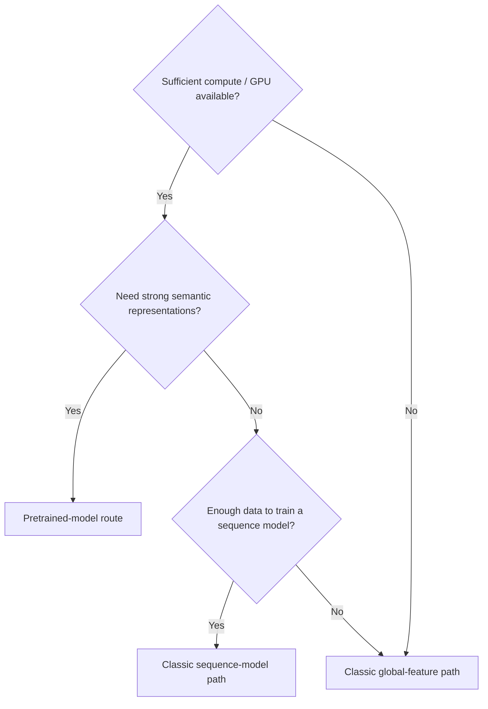

# Feature Routes

PepPlatform provides two feature-extraction routes: the **pretrained-model route** and the **classic-feature route**. They differ fundamentally in how tokenization, encoding, and downstream connections are organized.

## Route Comparison

| Dimension | Pretrained-model route | Classic-feature route |
| --- | --- | --- |
| Tokenizer + encoder | Bundled into one coherent feature extractor | Tokenizer and encoder selected independently |
| Supported models | ESM2, ProtBERT, ProtT5, ESMC, ESM3 | Tokenizers and encoders follow a compatibility matrix, not an unrestricted Cartesian product |
| Downstream connection | Pooled embedding → classifier; or residue features → trainable architecture | Global features -> classifier; or ordered features -> sequence model -> prediction head |
| Feature transforms | Not applicable | Optional (global-feature path only) |
| Sequence-model branch | Frozen residue representations → adapter → sequence/chain-graph architecture | Supports CNN/RNN/GRU/LSTM/Transformer |
| Pair guided path | two_stream; constrained residue-level single_stream | Both single_stream and two_stream |

## Pretrained-Model Route

Pretrained models bundle tokenization and encoding into a single unit whose output is already a semantic embedding, so no separate tokenizer or encoder selection is needed.

Supported pretrained models:

| Tokenizer ID | Default model |
| --- | --- |
| `esm2` | `facebook/esm2_t30_150M_UR50D` |
| `protbert` | `Rostlab/prot_bert` |
| `prott5` | `Rostlab/prot_t5_xl_uniref50` |
| `esmc` | `EvolutionaryScale/esmc-600m-2024-12` |
| `esm3` | `EvolutionaryScale/esm3-sm-open-v1` |

### Guided Flow

1. `Choose feature extraction`
2. `Choose pretrained model`
3. `Choose classifier`

## Classic-Feature Route

The classic route decouples tokenization from encoding. Encoder output splits into two sub-paths based on whether sequence order is preserved:

- **Global-feature path**: The encoder collapses the sequence into a single vector, optionally passed through a [feature transform](./feature-transforms), then fed to a classical classifier.
- **Sequence-model path**: The encoder preserves ordered per-position structure, fed to a [sequence model](./sequence-models), then connected to a prediction head or embedding export.

### Global-Feature Path Guided Flow

1. `Choose feature extraction`
2. `Choose tokenizer`
3. `Choose encoder`
4. `Choose feature transformation`
5. `Choose classifier`

Supported fitted feature transforms:

- `bow -> none / lsa / lda / plsa`
- `TF-IDF, textrank -> none / lsa`

LSA is uncentered truncated SVD for single-sequence classic global features. Single-sequence LDA and PLSA accept BoW raw counts; Pair LDA/PLSA are exposed only on the strict Two-stream classic-BoW, `fusion_mode=concat`, vector-interaction, classical-classifier route. Other Pair routes use `ml_reduction=tsvd` for generic dimensionality reduction.

Pair `ml_reduction=tsvd` uses the same TruncatedSVD primitive as LSA, but it acts
on fused generic numeric vectors. It is therefore a generic numeric reduction,
not an assertion that the fused vectors retain document-term semantics.
TSVD fits only on Train and freezes the uncentered randomized
transform for held-out and Web inference.

### Sequence-Model Path Guided Flow

1. `Choose feature extraction`
2. `Choose tokenizer`
3. `Choose encoder`
4. `Choose sequence model`
5. `Choose training mode`
6. If embeddings are exported, `Choose downstream classifier`

::: info Advanced Compatibility Route
Direct classification on flattened dense sequence-preserving features remains available as an advanced compatibility route, but it is not the default guided path.
:::

## How to Choose a Route

::: tip Selection Advice
- **Using pretrained representations**: Consider a pretrained-model route (e.g., ESM2) when its resources are available. Compare routes on the same validation protocol; no route is guaranteed to perform best.
- **Need interpretable classic features or a fast baseline**: Choose the classic global-feature path (e.g., kmer + onehot + SVM).
- **Interested in local sequence motifs with sufficient data**: Choose the classic sequence-model path (e.g., kmer + pssm + CNN).
:::

## Related Pages

- [Tokenizers](./tokenizers) — Full list of pretrained and classic tokenizers
- [Encoders](./encoders) — Classic encoders and their categories
- [Sequence Models](./sequence-models) — Sequence-model path details
- [Feature Transforms](./feature-transforms) — Optional transforms for the global-feature path

## Pretrained Residue Modeling

Pretrained models support pooled embeddings followed by a predictor, and frozen per-residue features followed by a trainable adapter and CNN/RNN/GRU/LSTM/Transformer or chain GCN/GAT. All five pretrained families expose residue architectures and training modes through capabilities; this is not restricted to ESM2. The pretrained encoder remains frozen on this route; end-to-end training refers to the trainable adapter/backbone/head. Validate length, mask and route constraints with Preflight.

Pretrained pair Single-stream is supported when both roles have matching representation settings and explicit valid-residue masks. It joins compact valid positions with a role boundary before joint modeling. Two-stream retains role identity until vector fusion or token interaction.
