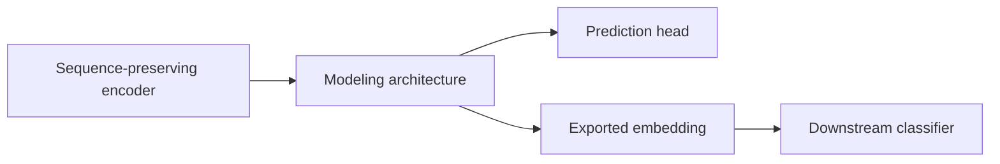

# Modeling Architectures

A modeling architecture operates on the output of a **sequence-preserving encoder**, modeling sequence or chain-graph relations among per-position features. The platform has five sequence architectures and two sequence chain-graph architectures. The compatibility config still stores their IDs in `--sequence_model`.

## Supported Architectures

| Model | Description |
| --- | --- |
| `cnn` | PepPlatform multi-scale residual 1-D convolution variant with 3/5/7-token windows for local motif patterns |
| `rnn` | Recurrent neural network; aggregates context step by step along the sequence |
| `gru` | Gated Recurrent Unit; reset/update gates control candidate and recurrent hidden-state updates |
| `lstm` | Long Short-Term Memory; input/forget/output gates control cell and hidden-state updates |
| `transformer` | Self-attention-based model; models full-sequence dependencies in parallel |
| `gcn` | Sequence chain-graph architecture; positions are nodes and adjacent positions form chain edges |
| `gat` | Attention-based sequence chain-graph architecture over the same position nodes |

The first five are **sequence architectures**. GCN and GAT are **sequence chain-graph architectures**. Sharing a compatibility field does not make GCN/GAT “sequence models” in paper or UI terminology.

## Connection

The modeling architecture sits between the encoder and the prediction head:



```text
encoder -> modeling architecture -> prediction head
                       or
                  exported embedding -> downstream classifier
```

::: warning Encoder constraints
All modeling architectures require [sequence-preserving encoders](./encoders#sequence-preserving-encoders). CNN/RNN/GRU/LSTM/Transformer may consume `index` and learn an internal embedding. GCN/GAT require per-position feature vectors and accept `onehot`, `blosum62`, `pssm`, `pssm_blosum62_hybrid`, `psfm`, `psfm_blosum62_hybrid`, `word2vec`, `glove`, or `fasttext`, but not raw `index` IDs. Global encoders should feed a [classifier](./classifiers) directly.
:::

## CNN Implementation Contract

The platform `cnn` is not a line-by-line reproduction of one published network. It combines a trainable input adapter, three two-layer residual `Conv1d` branches with kernel sizes 3/5/7, masked global-max readout, and a configurable prediction head. The `index` route derives its mask from nonzero token IDs; continuous position-feature and pretrained-residue routes consume explicit residue masks. New artifacts record this assembly in the CNN predictor contract.

The mask contract prevents padding from entering inter-layer convolution states or global-max readout. Historical unmasked CNN artifacts without this contract remain loadable only for compatibility; a formal CNN baseline must be retrained and cannot be assumed equivalent to the current masked implementation.

Algorithm lineage and implementation evidence:

- LeCun Y, Bottou L, Bengio Y, Haffner P. *Gradient-Based Learning Applied to Document Recognition*. Proceedings of the IEEE, 1998. DOI: `10.1109/5.726791`.
- Kim Y. *Convolutional Neural Networks for Sentence Classification*. EMNLP, 2014. DOI: `10.3115/v1/D14-1181`.
- He K, Zhang X, Ren S, Sun J. *Deep Residual Learning for Image Recognition*. CVPR, 2016. DOI: `10.1109/CVPR.2016.90`.
- Official PyTorch APIs for [`Embedding`](https://docs.pytorch.org/docs/stable/generated/torch.nn.Embedding.html) and [`Conv1d`](https://docs.pytorch.org/docs/stable/generated/torch.nn.Conv1d.html).

The three papers establish the lineage of convolutional networks, multi-window sequence convolution, and residual connections. They do not establish that PepPlatform strictly reproduces any one of those paper architectures.

## RNN Implementation Contract

The platform `rnn` is a bidirectional tanh Elman RNN variant. The index route uses a learned embedding, continuous position features retain their input width, and the pretrained-residue route uses a `LayerNorm -> Linear` adapter. All three routes compact valid positions in order from an explicit or token-derived mask and then run a packed `nn.RNN`. The readout concatenates the final forward and backward hidden states before the configurable prediction head.

This contract prevents right padding, padding between the two Pair segments, and masked feature values from entering the recurrence. Continuous-feature masks come from actual token/profile lengths, so a valid all-zero OOV embedding or profile row is not removed. New end-to-end artifacts record the assembly in `predictor_contract`; export routes store the same evidence in `architecture_contract`.

Algorithm lineage and implementation evidence:

- Elman JL. *Finding Structure in Time*. Cognitive Science, 1990. DOI: `10.1207/s15516709cog1402_1`.
- Schuster M, Paliwal KK. *Bidirectional Recurrent Neural Networks*. IEEE Transactions on Signal Processing, 1997. DOI: `10.1109/78.650093`.
- Official PyTorch APIs for [`RNN`](https://docs.pytorch.org/docs/stable/generated/torch.nn.RNN.html) and [`pack_padded_sequence`](https://docs.pytorch.org/docs/stable/generated/torch.nn.utils.rnn.pack_padded_sequence.html).

These sources establish Elman recurrence, the bidirectional extension, and the runtime primitives. PepPlatform's adapters, hidden width, readout, and head are platform adaptations rather than a strict reproduction of either complete paper model.

## GRU Implementation Contract

The platform `gru` is a bidirectional PyTorch-GRU variant. GRU identity comes from the reset gate, update gate, candidate state, and gated hidden-state update. For efficiency, PyTorch applies the reset gate after the hidden affine operation, whereas the original Cho formula applies it before that operation. The implementation is therefore in the GRU family but is not a line-by-line reproduction of the original cell equation.

The index route uses a learned embedding, continuous position features retain their input width, and the pretrained-residue route uses a `LayerNorm -> Linear` adapter. All three routes compact valid positions in order from an explicit or token-derived mask and then run a packed `nn.GRU`. The readout concatenates the final forward and backward hidden states before the configurable prediction head.

The mask contract prevents right padding, padding between Pair segments, and masked feature values from entering recurrence. Continuous-feature masks come from actual token/profile lengths, so a valid all-zero OOV embedding or profile row is retained. New end-to-end artifacts record the actual cell, PyTorch gate variant, directions, mask, and readout in `predictor_contract`; export routes store the same evidence in `architecture_contract`.

Algorithm lineage and implementation evidence:

- Cho K, van Merriënboer B, Gulcehre C, et al. *Learning Phrase Representations using RNN Encoder-Decoder for Statistical Machine Translation*. EMNLP, 2014. DOI: `10.3115/v1/D14-1179`.
- Schuster M, Paliwal KK. *Bidirectional Recurrent Neural Networks*. IEEE Transactions on Signal Processing, 1997. DOI: `10.1109/78.650093`.
- Official PyTorch APIs for [`GRU`](https://docs.pytorch.org/docs/stable/generated/torch.nn.GRU.html) and [`pack_padded_sequence`](https://docs.pytorch.org/docs/stable/generated/torch.nn.utils.rnn.pack_padded_sequence.html).

These sources establish GRU gating, the bidirectional extension, and the runtime primitives. PepPlatform's adapters, bidirectional composition, hidden width, readout, and head are platform adaptations rather than a strict reproduction of either complete paper model.

## LSTM Implementation Contract

The platform `lstm` is a bidirectional modern PyTorch-LSTM variant. LSTM identity comes from the input, forget, cell-candidate, and output gates together with distinct cell and hidden states. The original 1997 LSTM did not include the adaptive forget gate used by the current PyTorch cell, so this implementation belongs to the modern LSTM lineage rather than reproducing the original cell equations line by line.

The index route uses a learned embedding, continuous position features retain their input width, and the pretrained-residue route uses a `LayerNorm -> Linear` adapter. All three routes compact valid positions in order from an explicit or token-derived mask and then run a packed `nn.LSTM`. The readout concatenates the final forward and backward hidden states before the configurable prediction head; the final cell state does not directly enter the readout.

The mask contract prevents right padding, padding between Pair segments, and masked feature values from entering recurrence. Continuous-feature masks come from actual token/profile lengths, so a valid all-zero OOV embedding or profile row is retained. New end-to-end artifacts record the four-gate layout, hidden/cell states, directions, mask, and readout in `predictor_contract`; export routes store the same evidence in `architecture_contract`.

Algorithm lineage and implementation evidence:

- Hochreiter S, Schmidhuber J. *Long Short-Term Memory*. Neural Computation, 1997. DOI: `10.1162/neco.1997.9.8.1735`.
- Gers FA, Schmidhuber J, Cummins F. *Learning to Forget: Continual Prediction with LSTM*. Neural Computation, 2000. DOI: `10.1162/089976600300015015`.
- Schuster M, Paliwal KK. *Bidirectional Recurrent Neural Networks*. IEEE Transactions on Signal Processing, 1997. DOI: `10.1109/78.650093`.
- Official PyTorch APIs for [`LSTM`](https://docs.pytorch.org/docs/stable/generated/torch.nn.LSTM.html) and [`pack_padded_sequence`](https://docs.pytorch.org/docs/stable/generated/torch.nn.utils.rnn.pack_padded_sequence.html).

These sources establish the original LSTM, its forget-gate extension, the bidirectional extension, and the runtime primitives. PepPlatform's adapters, bidirectional composition, hidden width, readout, and head are platform adaptations rather than a strict reproduction of any complete paper model.

## Transformer Implementation Contract

The platform `transformer` is an encoder-only PyTorch Transformer variant. Its algorithm identity comes from multi-head scaled dot-product self-attention, position-wise feed-forward networks, residual connections, LayerNorm, and positional information. It does not include the paper's autoregressive decoder or reproduce its machine-translation training setup.

The index route uses a learned token embedding, continuous position features use a linear projection, and the pretrained-residue route uses a `LayerNorm -> Linear` adapter. All three routes use learned absolute positional embeddings, a two-layer `nn.TransformerEncoder`, GELU, a key-padding mask, and masked-mean readout before the configurable prediction head. Valid-token position IDs are accumulated from the mask, so right padding, padding between Pair segments, and masked feature values do not change the effective sequence representation. Explicit continuous-feature masks also retain valid all-zero OOV embeddings or profile rows.

New end-to-end artifacts record self-attention, layer/head/FFN settings, position indexing, masks, and readout in `predictor_contract`; export routes store the same evidence in `architecture_contract`. The original paper also reported similar results for learned and sinusoidal positional encodings, but PepPlatform's choice remains a platform adaptation.

Algorithm and implementation evidence:

- Vaswani A, Shazeer N, Parmar N, et al. *Attention Is All You Need*. NeurIPS, 2017:5998-6008.
- Official PyTorch APIs for [`TransformerEncoderLayer`](https://docs.pytorch.org/docs/stable/generated/torch.nn.TransformerEncoderLayer.html), [`TransformerEncoder`](https://docs.pytorch.org/docs/stable/generated/torch.nn.TransformerEncoder.html), [`MultiheadAttention`](https://docs.pytorch.org/docs/stable/generated/torch.nn.MultiheadAttention.html), and [`Embedding`](https://docs.pytorch.org/docs/stable/generated/torch.nn.Embedding.html).

These sources establish the Transformer encoder mechanisms and the runtime primitive semantics. PepPlatform's adapters, learned positions, width/depth, GELU, masked-mean readout, and head are platform adaptations rather than a strict reproduction of the complete paper model.

## Pretrained Residue Modeling

ESM2, ProtBERT, ProtT5, ESM-C, and ESM3 can all emit explicitly masked per-residue representations. These feed CNN/RNN/GRU/LSTM/Transformer residue-sequence architectures or GCN/GAT residue chain-graph architectures. Every such route supports `end_to_end` and `export_embeddings`; the latter exports the architecture readout and then trains the final classical classifier.

GCN/GAT/GraphSAGE/Graph Transformer in pair Two-stream vector routes use fused samples as nodes. HGT instead uses typed peptide and partner nodes with a pair-edge decoder. These are [pair graph architectures](./pair-interaction), not chain-graph architectures.

## Training Modes

The classic modeling-architecture path supports two training modes; see [Training Modes](./training-modes):

- **`end_to_end`**: The sequence model is trained jointly with a neural prediction head (MLP).
- **`export_embeddings`**: The sequence model is trained with a temporary neural head; the best checkpoint is restored, embeddings are exported, and a downstream classical classifier is trained as the final predictor.

## Guided Flow

1. `Choose feature extraction`
2. `Choose tokenizer`
3. `Choose encoder`
4. `Choose modeling architecture`
5. `Choose training mode`
6. If embeddings are exported, `Choose downstream classifier`

## Training Hyperparameters

Modeling architectures share the following training hyperparameters:

| Parameter | Description |
| --- | --- |
| `--max_length` | Maximum encoded positions; `kmer` truncates by K-mer token count, while other routes follow their tokenizer contract |
| `--batch_size` | Batch size |
| `--lr` | Learning rate |
| `--epochs` | Training epochs |
| `--dropout` | Dropout rate |
| `--weight_decay` | Weight decay |
| `--grad_clip_norm` | Gradient clipping norm |
| `--early_stop_patience` | Early-stopping patience |
| `--early_stop_min_delta` | Early-stopping minimum delta |
| `--dl_scaler` | Deep-learning input scaling: `none` / `standard` |

## Compatibility

::: info Legacy Command Mapping
Legacy `--model` and `--sequence_model` fields remain compatible. `sequence_model` is a historical field name that can store a sequence or chain-graph architecture; it does not determine paper terminology. Use `--training_mode` and `--classifier` to state the optimization organization and terminal decision component explicitly.
:::

::: warning Historical RNN Implementation
Early `rnn` and `gru` options both constructed a bidirectional `nn.GRU`; some later true-RNN artifacts also predate the current mask contract. Any `rnn` artifact without the required mask contract is therefore `legacy_only`: it remains loadable with an explicit warning, but it must not be compared with `gru` as an independent method or treated as the current padding-invariant RNN baseline. Formal results require retraining with the recorded mask and readout semantics.
:::

::: warning Historical GRU Implementation
The historical index GRU admitted padding into bidirectional recurrence, classic continuous-feature routes could mistake valid all-zero positions for padding, and pretrained-residue routes did not handle internal mask holes correctly. Historical full-object artifacts remain loadable along their numerical legacy paths with an explicit warning, but they are not current padding-invariant GRU baselines and must be retrained for formal comparisons.
:::

::: warning Historical LSTM Implementation
The historical index LSTM admitted padding into bidirectional recurrence, classic continuous-feature routes could mistake valid all-zero positions for padding, and pretrained-residue routes did not handle internal mask holes correctly. Historical full-object artifacts remain loadable along their route-specific numerical legacy paths with an explicit warning, but they are not current padding-invariant LSTM baselines and must be retrained for formal comparisons.
:::

::: warning Historical Transformer Implementation
Historical Transformer position IDs followed raw padded-tensor slots, so padding between Pair segments or other internal mask holes changed the positional representation of later valid tokens. Classic continuous-feature routes could also mistake valid all-zero positions for padding. Historical full-object artifacts remain loadable along their numerical legacy paths with an explicit warning, but they are not current mask-aware Transformer baselines and must be retrained for formal comparisons.
:::

::: warning Historical CNN Implementation
The historical index CNN used BatchNorm-bearing unmasked residual blocks and max-pooled across the padded full length, so its representation could change with right-padding length. Historical full-object artifacts remain loadable with an explicit legacy warning, but they are not current padding-invariant CNN baselines and must be retrained for formal comparisons.
:::

## Related Pages

- [Encoders](./encoders) — Sequence-preserving vs global encoder categories
- [Training Modes](./training-modes) — end_to_end vs export_embeddings explained
- [Classifiers](./classifiers) — Neural MLP and classical classifiers

## Pretrained Residue Inputs

All five pretrained families can feed frozen residue features through a trainable adapter into sequence or chain-graph architectures. Explicit masks preserve valid positions. `end_to_end` trains the adapter/backbone/head while keeping the pretrained encoder frozen; `export_embeddings` then fits the selected classical downstream model. See [Feature Routes](./routes).
