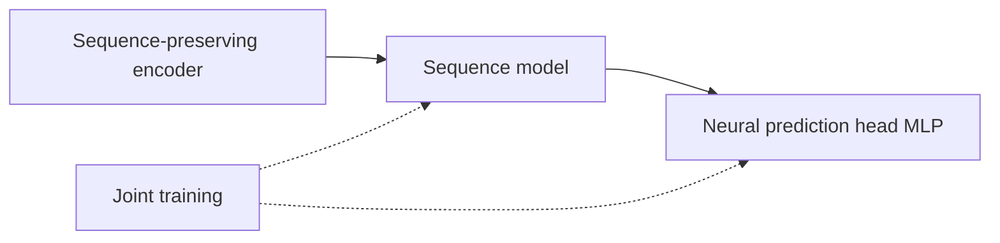
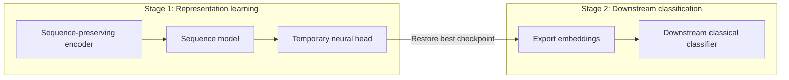

# Training Modes

The training mode determines how the sequence model and prediction head are organized in the [sequence model](./sequence-models) path (and pair-task paths). The platform supports two training modes, selected via the `--training_mode` argument.

## Mode Overview

| Mode | Description |
| --- | --- |
| `end_to_end` | End-to-end prediction: the sequence model and neural prediction head are trained together |
| `export_embeddings` | Export embeddings: the sequence model is trained with a temporary head, embeddings are exported, then a downstream classical classifier is trained |

The mode/classifier pairing is part of the contract: `end_to_end` uses an `MLP`
prediction head, while `export_embeddings` requires a classical downstream
classifier such as SVM, Random Forest, ExtraTrees, HistGB, XGBoost, LightGBM,
or Logistic Regression.

Pretrained encoders remain frozen in these routes. Here, joint training refers to the supported adapter, sequence/interaction model and prediction head, not fine-tuning the pretrained backbone.

## end_to_end — End-to-End Prediction

The sequence model and neural prediction head (MLP) are trained jointly; gradients backpropagate from the head into the sequence model.

::: tip When to Use
- Sufficient data, with the sequence model and prediction head co-optimized.
- You want to train the supported task model and prediction head jointly.
- The legacy `--model cnn|rnn|gru|lstm|transformer` default maps to this mode (`classifier=mlp`).
:::

## export_embeddings — Export Embeddings

Completed in two stages:

1. **Representation learning stage**: The sequence model is trained with a temporary neural head to learn useful sequence representations.
2. **Downstream classification stage**: The best checkpoint is restored, embeddings are exported, and a downstream classical [classifier](./classifiers) is trained as the final predictor.

::: warning Temporary-Head Metrics Are Diagnostic
Temporary-head metrics monitor representation-learning quality and are **not the final model result**. The final model result should be based on the stage-2 downstream classifier metrics.
:::

### When to Use

- You want a classical classifier (SVM, Random Forest, XGBoost, etc.) instead of a neural prediction head.
- You want reusable sequence embeddings for multiple downstream tasks.
- You want to compare downstream classifiers on the same exported representation; performance depends on the data and evaluation protocol.

## Position in the Guided Flow

In the sequence-model path guided flow, the training mode is step 5:

1. `Choose feature extraction`
2. `Choose tokenizer`
3. `Choose encoder`
4. `Choose sequence model`
5. **`Choose training mode`**
6. If embeddings are exported, `Choose downstream classifier`

## Pair-Task Training Modes

Pair tasks follow the same two-stage convention:

- **single_stream**: The concatenated sequence is modeled by a sequence model, with end_to_end or export_embeddings optional.
- **two_stream + token-level interaction**: The interaction encoder (cross_attn / bi_cross_attn) can be trained jointly with a neural head in `end_to_end`, or with a temporary head followed by exported embeddings and a classical classifier in `export_embeddings`.

See [Pair Interaction](./pair-interaction).

## Compatibility

::: info Legacy Command Mapping
Legacy `--model cnn|rnn|gru|lstm|transformer` commands map to `sequence_model=<model>`, `training_mode=end_to_end`, and `classifier=mlp`. The recommended new syntax uses the three role-level arguments `--sequence_model`, `--training_mode`, and `--classifier` to expose the clearer model structure.
:::

## Related Pages

- [Sequence Models](./sequence-models) — Connection between sequence models and prediction heads
- [Classifiers](./classifiers) — Downstream classical classifiers and auto-tuning
- [Pair Interaction](./pair-interaction) — Pair-task embedding export convention

## Selection and Reuse

Checkpoint, threshold and tuning targets are documented in [Selection Objectives](../concepts/selection-objectives). Reusing an existing failed SVM representation is a separate [downstream resume workflow](../web-ui/versions-and-resume), rather than a third training mode.
