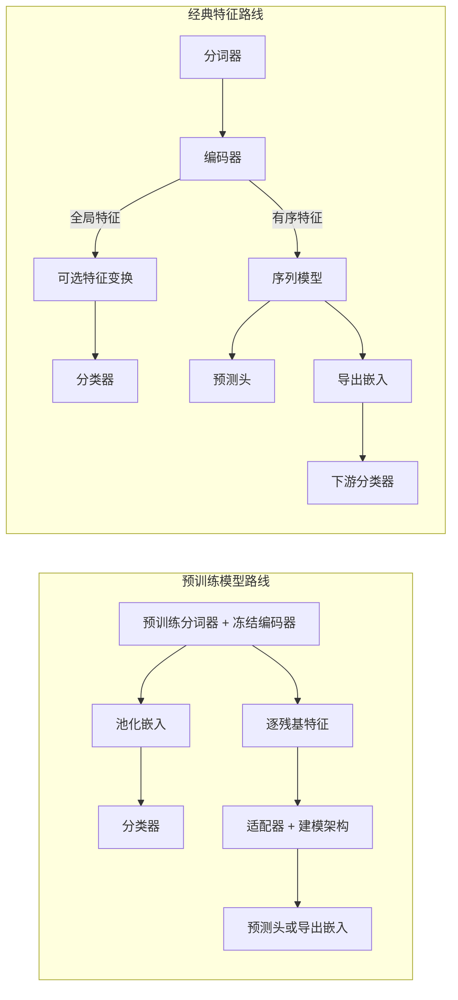

# 总览

PepPlatform 是一个面向肽段预测的统一机器学习平台。它将数据处理、序列表示、模型训练、独立测试与分析、实验管理、模型复用与推理整合进同一套工作流。平台同时提供 **Web 端**可视化实验管理与 **CLI 端**批量训练脚本两套接口。

平台支持的四类分类任务组织为三种输入设置——仅肽段、肽段–靶标序列、肽段–HLA 等位基因——并通过四个任务接口实现。

| 输入设置 | 任务接口 | 预测目标 |
| --- | --- | --- |
| 仅肽段 | `pep_function` | 治疗性肽功能（二分类或多标签） |
| 肽段–靶标序列 | `pep_protein_interaction` | 肽–蛋白相互作用（二分类） |
| 肽段–HLA 等位基因 | `pep_hlai`、`pep_hlaii` | HLA-I / HLA-II 配体呈递（二分类） |

## 建模维度

平台的建模选择沿三个互补维度组织。这些维度借自语言学，用于在可配置项之间导航，而非一条固定流水线：

- **语法（Syntax）**：序列分词与编码，覆盖经典编码与预训练蛋白表示。参见[分词器](./tokenizers)与[编码器](./encoders)。
- **语义（Semantics）**：可选的关系引导监督，使可微表示反映训练数据隐含的标签相似结构。参见[语义辅助损失](./semantic-loss)。
- **语用（Pragmatics）**：预测设定与输入组织，区分仅肽段输入与以靶标蛋白或 HLA 等位基因为条件的建模。参见 [Pair 互作](./pair-interaction)。

## 核心能力

| 维度 | 内容 |
| --- | --- |
| 任务类型 | 四个任务接口：肽功能、肽–蛋白相互作用、HLA-I 与 HLA-II 配体呈递 |
| 特征路线 | 预训练模型路线、经典特征路线 |
| 接口 | Web 可视化向导 + CLI 训练脚本 |
| 模型范围 | 序列模型（CNN/RNN/GRU/LSTM/Transformer）、经典分类器、图预测器 |

详见 [任务类型](./tasks) 与 [特征路线](./routes)。

## 关键术语

理解以下术语有助于把握平台的设计理念：

- **编码器（Encoder）**：平台将分词后的序列转换为数值输入的统称。它既包含 BoW 等经典编码，也包含 word2vec 等静态嵌入这类带有语义的输入。
- **表征（Representation）**：专指几何上承载有用语义的向量。并非所有编码器输出都是表征：index ID、one-hot、BoW 向量是有效的编码，但未必定义一个语义空间。
- **保序编码器（Sequence-preserving encoders）**：保留有序的逐位置结构，其输出可由 CNN、GRU、LSTM 或 Transformer 序列模型建模。
- **全局编码器（Global encoders）**：将序列压缩为一个向量，直接交给下游分类器，可选地在特征变换之后使用。

::: tip 编码器 vs 表征
"编码器"是平台对所有数值化方法的统称；"表征"特指具有语义几何的向量。一个编码器输出是否构成表征取决于其语义性质，而非是否被叫做嵌入。
:::

详见 [编码器](./encoders)。

## 高层工作流

平台有两条特征提取入口，分别对应预训练模型路线与经典特征路线：



对应的文本表示：

```text
pretrained model
  pretrained tokenizer + frozen encoder -> pooled embedding -> classifier
                                  or -> residue features -> adapter + backbone -> head/export

classic pipeline
  tokenizer -> encoder
               |- global features -> optional feature transformation -> classifier
               `- ordered features -> sequence model -> prediction head
                                             or
                                        exported embedding -> downstream classifier
```

预训练模型是一条独立路径，因为它已将分词与编码捆绑为一个连贯的特征提取器。

::: info 论文级简写
对于简洁的论文级描述，`tokenizer -> encoder -> classifier` 是经典全局特征路径的有效简写。完整的系统描述应明确提及序列模型分支与预训练模型分支。
:::

## 引导式流程

所有面向用户的向导提示均为英文。各路线的引导步骤参见 [特征路线](./routes)；Pair 任务的引导步骤参见 [Pair 互作](./pair-interaction)。

## 兼容性说明

- 文档列出的旧版 `--model` 别名仍可接受；已移除或不兼容的路线仍会校验失败。
- 旧版 `--model cnn|rnn|gru|lstm|transformer` 命令会映射为 `sequence_model=<model>`、`training_mode=end_to_end`、`classifier=mlp`。
- 新的角色级设置通过 `--sequence_model`、`--training_mode`、`--classifier` 暴露更清晰的模型结构。
- Pair 任务通过 `--pair_strategy`、`--interaction_level`、`--interaction_model`、`--predictor_type`、`--graph_predictor` 暴露其结构。
- 旧版 Pair 别名仍被接受：`--ppi_interaction_mode`、`--hlaii_interaction_mode`，以及 Pair 任务的 `--model` 值（如 `cross_attn+mlp`、`bi_cross_attn+mlp` 或图模型名称）会被规范化为显式的角色级字段。
