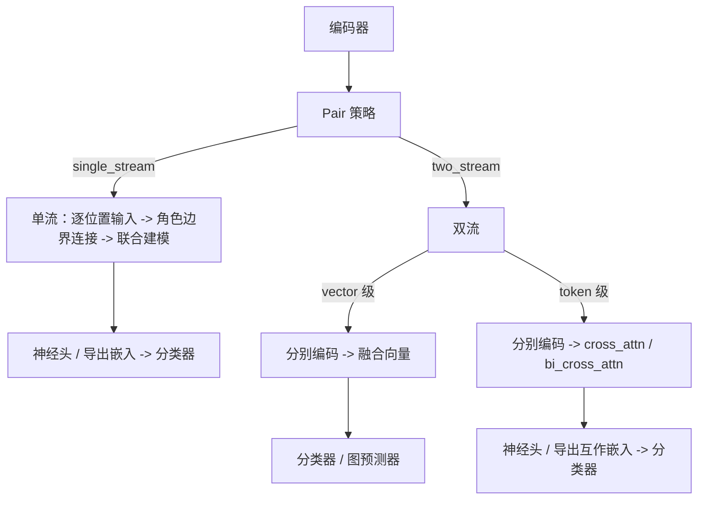

# Pair 互作

Pair 互作任务（肽–蛋白、肽–HLA-I、肽–HLA-II）在编码器与最终预测器之间增加一个显式层级，用于建模两条序列之间的相互作用。


stream 描述下游配对输入的组织方式，与上游编码器数量及参数共享分别讨论。**Single-stream（单流）**先连接两侧逐位置输入并保留角色边界，再进入 **joint modeling backbone**；预训练路线先分别编码两侧，再连接残基表示。**Two-stream（双流）**保留两侧身份，直到向量融合或 token 级跨侧交互，之后可以形成联合表示。HGT 保留类型化角色节点并进行配对边预测。peptide-only 单序列任务不属于这组分类。

CLI/API 使用 `single_stream` / `two_stream`，也接受连字符拼写。旧值 `single_tower` / `dual_tower` 继续作为输入接受，并规范化为当前 stream 名称。冻结制品保留其登记的标识，通过兼容适配器读取，不改写原件。当前单流实现要求两侧表示配置一致；同构／异构和权重共享须分别说明。

## 工作流总览



对应的文本表示：

```text
encoder
  -> pair strategy
       |- single_stream
       |    use matching peptide/partner representation settings
       |    -> compact valid positions + explicit role boundary + right padding
       |    -> sequence model
       |    -> neural head or exported embedding -> classifier
       |
       `- two_stream
            |- vector-level interaction
            |    encode each side separately -> fuse vectors
            |    -> classifier or sample-graph predictor
            |
            `- token-level interaction
                 encode each side separately -> cross_attn / bi_cross_attn
                 -> neural head or exported interaction embedding -> classifier
```

## Pair 策略

Pair 策略（`--pair_strategy`）决定两条序列如何组织：

| 策略 | 说明 |
| --- | --- |
| `single_stream` | 使用一致的两侧表示配置，压紧两侧有效位置并加入显式角色边界，再交给序列模型建模 |
| `two_stream` | 分别编码两侧，在向量级或 token 级进行交互融合 |

## 交互层级

仅 `two_stream` 策略需要选择交互层级（`--interaction_level`）：

| 层级 | 说明 | 交互模型 |
| --- | --- | --- |
| `vector` | 向量级交互，融合两侧向量后交给预测器 | — |
| `token` | token 级交互，使用交叉注意力建模两侧 token 间的关系 | `cross_attn` / `bi_cross_attn` |

### 交互模型

token 级交互可选两种交互模型（`--interaction_model`）：

| 模型 | 说明 |
| --- | --- |
| `cross_attn` | 单向交叉注意力 |
| `bi_cross_attn` | 双向交叉注意力，两侧分别作为 query，并为两个方向使用独立注意力参数 |

## 预测器类型

向量级交互需要选择预测器类型（`--predictor_type`）：

| 预测器 | 说明 |
| --- | --- |
| `classifier` | 使用经典或神经[分类器](./classifiers) |
| `sample_graph` | 使用图神经网络预测器 |

### 图预测器

图预测器（`--graph_predictor`）作用于双流向量。GCN、GAT、GraphSAGE 和 Graph Transformer 构建融合样本节点图；HGT 保留 peptide 与 partner 两种节点类型并预测类型化 Pair 边：

| 图预测器 | 说明 |
| --- | --- |
| `gcn` | Graph Convolutional Network |
| `gat` | Graph Attention Network |
| `hgt` | 类型化 peptide-partner Heterogeneous Graph Transformer |
| `sage` | GraphSAGE |
| `graph_transformer` | 稀疏样本图 masked multi-head Graph Transformer |

::: warning 图预测器的适用范围
图预测器族只保留在 Two-stream 向量路由。Graph Transformer 对融合样本的 kNN 边执行图结构约束的多头 scaled dot-product attention；每个 query 只接收 train-reference 消息。HGT 使用角色特定的 semantic kNN 关系，不把候选 PPI 标签边加入消息传递，并对 peptide-partner 边解码。HGT 使用类型化角色投影，因此不提供融合模式选择；历史 `concat`/`concat_all` 值仅作为被忽略的兼容标记。缺少当前 Graph Transformer/HGT contract 的历史 bundle 仅为 legacy。
:::

## 融合模式

向量级交互的融合模式（`--fusion_mode`，默认 `concat_all`）：

| 融合模式 | 说明 |
| --- | --- |
| `concat_all` | `[peptide, partner, abs(peptide-partner), peptide*partner]` |
| `concat` | 按角色顺序 `[peptide, partner]`；允许两侧宽度不同 |
| `concat_absdiff` | `[peptide, partner, abs(peptide-partner)]`；要求两侧等宽 |
| `concat_hadamard` | `[peptide, partner, peptide*partner]`；要求两侧等宽 |
| `gated(static)` / `gated` | `g=sigmoid(sum(peptide*partner))`；输出 `[g*peptide+(1-g)*partner, abs(peptide-partner), peptide*partner]`；要求两侧等宽 |
| `aligned_gated` | PepPlatform learned elementwise convex-gating variant；异构 tower 先分别投影到 `stream_alignment_dim`，同宽 tower 使用 identity projection；gate 输入包含两侧 aligned 向量、绝对差和 Hadamard 积，输出再拼接绝对差与 Hadamard 积；要求神经 Prediction Head |

所有融合模式均消费稠密、有限的二维 tower 向量并输出 `float32`。确定性融合制品通过 `pair_fusion_contract` 绑定模式、角色顺序和维度；新的 `aligned_gated` 制品另写入 `aligned_gated_contract`，绑定 projection、gate 结构、输出块和运行时版本。缺少当前合同的历史制品仅保留原数值推理并标为 `legacy_only`，正式基线需要重新训练。静态 gate 是 PepPlatform 的相似度门控变体，不是 learned GMU 或 `aligned_gated`。`aligned_gated` 的 gate 与 Prediction Head 始终可训练；仅异构 tower 使用可学习 projection。

## 引导流程

Pair 任务的引导流程如下：

1. `Choose feature extraction`
2. `Choose pretrained model` 或 `Choose tokenizer`
3. 若使用经典路线，`Choose encoder`
4. `Choose pair strategy`
5. 若 `single_stream`：
   - `Choose sequence model`
   - `Choose training mode`
   - 若导出嵌入，`Choose downstream classifier`
6. 若 `two_stream`：
   - `Choose interaction level`
   - 向量级交互（`vector`）：
     - `Choose predictor type`
     - 然后 `Choose classifier` 或 `Choose sample-graph predictor`
     - `Choose fusion`
   - token 级交互（`token`）：
     - `Choose interaction model`
     - `Choose training mode`
     - 若导出嵌入，`Choose downstream classifier`

## 预训练 Pair 任务

::: info 预训练 Pair 策略
Two-stream 是常用路线；当前也支持两侧配置一致、显式有效位置 mask 的逐残基 Single-stream，以角色边界连接后联合建模。它不是原始序列任意拼接，也不支持任意异构两侧配置。
:::

## 导出嵌入约定

Pair 任务的导出路由采用与序列任务相同的两阶段约定：

1. 以临时神经头训练序列或交互编码器；
2. 恢复最佳检查点，导出嵌入；
3. 训练所选的下游分类器作为最终预测器。

::: warning 临时头指标
临时头指标是表征学习的诊断信息，而非最终模型结果。详见 [训练模式](./training-modes)。
:::

## 相关页面

- [任务类型](./tasks) — 三个 Pair 任务的输入与输出
- [训练模式](./training-modes) — end_to_end 与 export_embeddings 详解
- [语义辅助损失](./semantic-loss) — Pair 任务的语义辅助损失
