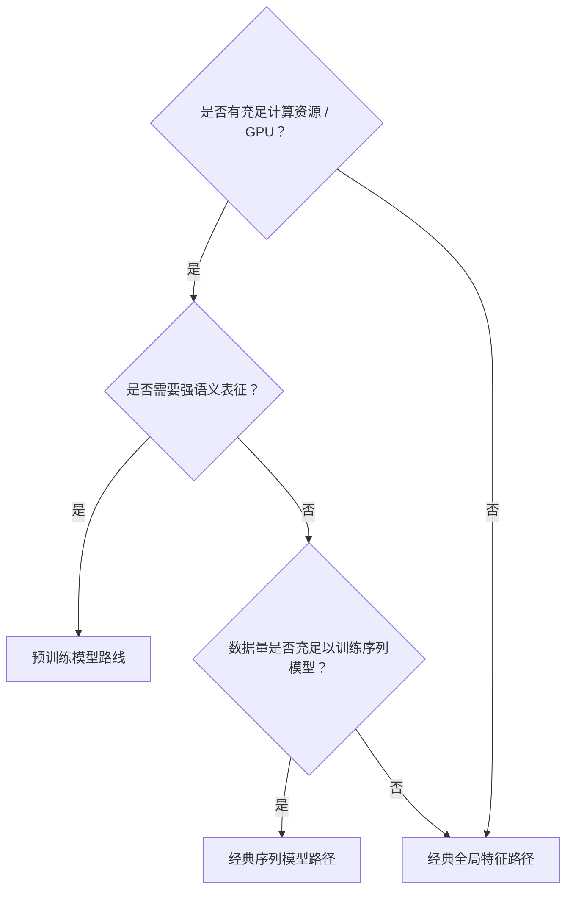

# 特征路线

PepPlatform 提供两条特征提取路线：**预训练模型路线**与**经典特征路线**。两者在分词、编码与下游衔接方式上有本质区别。

## 路线对比

| 维度 | 预训练模型路线 | 经典特征路线 |
| --- | --- | --- |
| 分词 + 编码 | 捆绑为一个连贯的特征提取器 | 分词器与编码器可独立选择 |
| 支持模型 | ESM2、ProtBERT、ProtT5、ESMC、ESM3 | 分词器与编码器按支持矩阵组合，并非任意笛卡尔积 |
| 下游衔接 | 池化嵌入 → 分类器；或逐残基特征 → 可训练建模架构 | 全局特征 -> 分类器；或有序特征 -> 序列模型 -> 预测头 |
| 特征变换 | 不适用 | 可选（仅全局特征路径） |
| 序列模型分支 | 支持冻结逐残基表征 → 适配器 → 序列/链图架构 | 支持 CNN/RNN/GRU/LSTM/Transformer |
| Pair 引导路径 | two_stream；受约束的逐残基 single_stream | single_stream 与 two_stream 均可 |

## 预训练模型路线

预训练模型将分词与编码捆绑为一个整体，输出即为语义嵌入，无需再选分词器或编码器。

支持的预训练模型：

| 分词器 ID | 默认模型 |
| --- | --- |
| `esm2` | `facebook/esm2_t30_150M_UR50D` |
| `protbert` | `Rostlab/prot_bert` |
| `prott5` | `Rostlab/prot_t5_xl_uniref50` |
| `esmc` | `EvolutionaryScale/esmc-600m-2024-12` |
| `esm3` | `EvolutionaryScale/esm3-sm-open-v1` |

### 引导流程

1. `Choose feature extraction`
2. `Choose pretrained model`
3. `Choose classifier`

## 经典特征路线

经典路线将分词与编码解耦，编码器输出按是否保留序列顺序分为两条子路径：

- **全局特征路径**：编码器将序列压缩为一个向量，经可选的[特征变换](./feature-transforms)后交给经典分类器。
- **序列模型路径**：编码器保留有序的逐位置结构，交给[序列模型](./sequence-models)建模，再接预测头或导出嵌入。

### 全局特征路径引导流程

1. `Choose feature extraction`
2. `Choose tokenizer`
3. `Choose encoder`
4. `Choose feature transformation`
5. `Choose classifier`

支持的拟合型特征变换：

- `bow -> none / lsa / lda / plsa`
- `TF-IDF, textrank -> none / lsa`

其中 LSA 是仅面向单序列经典全局特征的非中心化截断 SVD；LDA 与 PLSA 的单序列路线只接受 BoW 原始计数。Pair 仅在双流 classic BoW、`fusion_mode=concat`、vector interaction 和 classical classifier 的严格 route 下提供 LDA/PLSA；其他 Pair 路线继续使用 `ml_reduction=tsvd`。

Pair 的 `ml_reduction=tsvd` 与 LSA 使用相同的 TruncatedSVD 算子，但它作用于
融合后的通用数值向量，属于 generic numeric reduction，不代表这些向量仍具有
文档-term 语义。
TSVD 只在 Train 上拟合，并将不中心化 randomized 变换冻结用于
held-out 数据和 Web 推理。

### 序列模型路径引导流程

1. `Choose feature extraction`
2. `Choose tokenizer`
3. `Choose encoder`
4. `Choose sequence model`
5. `Choose training mode`
6. 若导出嵌入，`Choose downstream classifier`

::: info 高级兼容路由
对展平的稠密保序特征直接分类仍可作为高级兼容路由使用，但不是默认的引导路径。
:::

## 如何选择路线

::: tip 选择建议
- **使用预训练表示**：资源条件满足时，可考虑预训练模型路线（如 ESM2）。应在相同验证协议下比较路线，不保证某条路线的性能最优。
- **需要可解释的经典特征或快速基线**：选择经典全局特征路径（如 kmer + onehot + SVM）。
- **关注序列局部模式（motif）且数据充足**：选择经典序列模型路径（如 kmer + pssm + CNN）。
:::

## 相关页面

- [分词器](./tokenizers) — 预训练与经典分词器的完整列表
- [编码器](./encoders) — 经典编码器及其分类
- [序列模型](./sequence-models) — 序列模型路径详解
- [特征变换](./feature-transforms) — 全局特征路径的可选变换

## 预训练逐残基建模

预训练路线既可将池化嵌入交给预测器，也可将冻结的逐残基特征交给可训练适配器，再接 CNN/RNN/GRU/LSTM/Transformer 或链 GCN/GAT。五类预训练模型均通过 capabilities 暴露逐残基架构和训练模式，不再仅限 ESM2。该路线保持预训练编码器冻结；端到端训练指适配器、建模骨干和预测头的联合训练。长度、mask 与组合限制以 Preflight 为准。

预训练 Pair Single-stream 要求两侧表示配置一致并具有显式有效残基 mask；压紧有效位置、加入角色边界后进行联合建模。Two-stream 则保留两侧身份直到向量融合或 token 交互。
