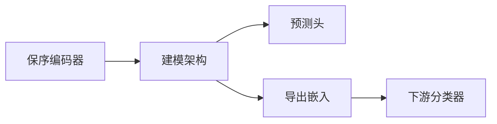

# 建模架构

建模架构（Modeling Architecture）作用于**保序编码器**的输出，对逐位置特征中的序列或链图关系进行建模。平台分为 5 种序列架构与 2 种序列链图架构；兼容配置仍通过 `--sequence_model` 参数保存架构 ID。

## 支持的架构

| 模型 | 说明 |
| --- | --- |
| `cnn` | PepPlatform 多尺度残差一维卷积变体，通过 3/5/7 三种卷积窗口捕捉局部 motif 模式 |
| `rnn` | 循环神经网络，沿序列方向逐步聚合上下文 |
| `gru` | Gated Recurrent Unit；以 reset/update gate 控制候选状态和循环隐藏状态更新 |
| `lstm` | Long Short-Term Memory；input/forget/output gates 控制 cell 与 hidden state 更新 |
| `transformer` | 基于 Self-Attention 的模型，并行建模全序列依赖 |
| `gcn` | 序列链图架构；位置为节点，相邻位置构成链边 |
| `gat` | 带注意力的序列链图架构；位置为节点，相邻位置构成链边 |

前五种属于**序列架构**，GCN/GAT 属于**序列链图架构**。它们共享兼容字段不代表 GCN/GAT 在论文或界面术语中被归为“序列模型”。

## 衔接方式

建模架构位于编码器与预测头之间：



```text
encoder -> modeling architecture -> prediction head
                       or
                  exported embedding -> downstream classifier
```

::: warning 编码器约束
所有建模架构仅适用于[保序编码器](./encoders#保序编码器)。CNN/RNN/GRU/LSTM/Transformer 可使用 `index` 并在内部学习 embedding；GCN/GAT 要求逐位置特征向量，只支持 `onehot`、`blosum62`、`pssm`、`pssm_blosum62_hybrid`、`psfm`、`psfm_blosum62_hybrid`、`word2vec`、`glove`、`fasttext`，不能直接使用 `index`。全局编码器应直接交给[分类器](./classifiers)。
:::

## CNN 实现契约

平台的 `cnn` 不是某篇论文网络的逐项复现。它由可训练 Input Adapter、三个 kernel size 为 3/5/7 的两层 residual `Conv1d` 分支、masked global max Readout 和可配置 prediction head 组成。`index` 路线从非零 token ID 得到 mask；连续逐位置特征和预训练残基路线使用显式 residue mask。新模型制品将该结构记录为 CNN Predictor contract。

掩码契约保证 padding 不进入卷积层间状态或 global max Readout。缺少该契约的历史 unmasked CNN 制品仅保留用于兼容推理；正式 CNN 基线必须重训，不能假定历史结果与当前带掩码的实现等价。

算法谱系与实现依据：

- LeCun Y, Bottou L, Bengio Y, Haffner P. *Gradient-Based Learning Applied to Document Recognition*. Proceedings of the IEEE, 1998. DOI: `10.1109/5.726791`。
- Kim Y. *Convolutional Neural Networks for Sentence Classification*. EMNLP, 2014. DOI: `10.3115/v1/D14-1181`。
- He K, Zhang X, Ren S, Sun J. *Deep Residual Learning for Image Recognition*. CVPR, 2016. DOI: `10.1109/CVPR.2016.90`。
- PyTorch [`Embedding`](https://docs.pytorch.org/docs/stable/generated/torch.nn.Embedding.html) 与 [`Conv1d`](https://docs.pytorch.org/docs/stable/generated/torch.nn.Conv1d.html) 官方 API。

前三篇分别界定卷积网络、多窗口序列卷积和 residual connection 的来源；它们不构成“PepPlatform 严格复现该论文模型”的证据。

## RNN 实现契约

平台的 `rnn` 是双向 tanh Elman RNN 变体。index 路线使用 learned embedding，连续逐位置特征保持原维度，预训练残基路线使用 `LayerNorm -> Linear` Adapter；三条路线都按显式或 token-derived mask 保序压紧有效位置，再用 packed sequence 运行 `nn.RNN`。Readout 拼接最后一层正向和反向最终隐藏状态，之后交给可配置 prediction head。

该契约保证右侧 padding、Pair 两段之间的内部 padding和 masked 特征值不会进入 recurrence。连续特征的 mask 来自真实 token/profile 长度，因此有效的全零 OOV embedding 或 profile 行不会被误删。新端到端制品在 `predictor_contract`、导出路线在 `architecture_contract` 中记录真实 cell、nonlinearity、方向、mask 和 Readout。

算法谱系与实现依据：

- Elman JL. *Finding Structure in Time*. Cognitive Science, 1990. DOI: `10.1207/s15516709cog1402_1`。
- Schuster M, Paliwal KK. *Bidirectional Recurrent Neural Networks*. IEEE Transactions on Signal Processing, 1997. DOI: `10.1109/78.650093`。
- PyTorch [`RNN`](https://docs.pytorch.org/docs/stable/generated/torch.nn.RNN.html) 与 [`pack_padded_sequence`](https://docs.pytorch.org/docs/stable/generated/torch.nn.utils.rnn.pack_padded_sequence.html) 官方 API。

这些来源界定 Elman recurrence、双向扩展和实际运行原语；PepPlatform 的 Adapter、隐藏宽度、Readout 与 Head 是平台适配，不构成对任一论文完整网络的严格复现。

## GRU 实现契约

平台的 `gru` 是双向 PyTorch-GRU 变体。GRU 的算法身份来自 reset gate、update gate、candidate state 和 gated hidden-state update；PyTorch 为效率在 hidden affine 之后施加 reset gate，与 Cho 原始公式的次序不同，因此当前实现属于 GRU 算法族，但不是原始 cell 公式的逐项复现。

index 路线使用 learned embedding，连续逐位置特征保持原维度，预训练残基路线使用 `LayerNorm -> Linear` Adapter。三条路线都按显式或 token-derived mask 保序压紧有效位置，再用 packed sequence 运行 `nn.GRU`。Readout 拼接最后一层正向和反向最终隐藏状态，之后交给可配置 prediction head。

掩码契约保证右侧 padding、Pair 两段之间的内部 padding和 masked 特征值不会进入 recurrence。连续特征的 mask 来自真实 token/profile 长度，因此有效的全零 OOV embedding 或 profile 行不会被误删。新端到端制品在 `predictor_contract`、导出路线在 `architecture_contract` 中记录实际 cell、PyTorch gate variant、方向、mask 和 Readout。

算法谱系与实现依据：

- Cho K, van Merriënboer B, Gulcehre C, et al. *Learning Phrase Representations using RNN Encoder-Decoder for Statistical Machine Translation*. EMNLP, 2014. DOI: `10.3115/v1/D14-1179`。
- Schuster M, Paliwal KK. *Bidirectional Recurrent Neural Networks*. IEEE Transactions on Signal Processing, 1997. DOI: `10.1109/78.650093`。
- PyTorch [`GRU`](https://docs.pytorch.org/docs/stable/generated/torch.nn.GRU.html) 与 [`pack_padded_sequence`](https://docs.pytorch.org/docs/stable/generated/torch.nn.utils.rnn.pack_padded_sequence.html) 官方 API。

上述来源分别界定 GRU gating、双向扩展和实际运行原语；PepPlatform 的 Adapter、双向组合、隐藏宽度、Readout 与 Head 是平台适配，不构成对任一论文完整网络的严格复现。

## LSTM 实现契约

平台的 `lstm` 是双向 modern PyTorch-LSTM 变体。LSTM 身份来自 input、forget、cell candidate、output 四门，以及独立的 cell/hidden state；1997 原始 LSTM 没有当前 PyTorch cell 使用的 adaptive forget gate，因此当前实现属于现代 LSTM 谱系，不是原始 cell 公式的逐项复现。

index 路线使用 learned embedding，连续逐位置特征保持原维度，预训练残基路线使用 `LayerNorm -> Linear` Adapter。三条路线都按显式或 token-derived mask 保序压紧有效位置，再用 packed sequence 运行 `nn.LSTM`。Readout 拼接最后一层正向和反向最终 hidden state，之后交给可配置 prediction head；最终 cell state 不直接进入 Readout。

掩码契约保证右侧 padding、Pair 两段之间的内部 padding和 masked 特征值不会进入 recurrence。连续特征的 mask 来自真实 token/profile 长度，因此有效的全零 OOV embedding 或 profile 行不会被误删。新端到端制品在 `predictor_contract`、导出路线在 `architecture_contract` 中记录四门布局、hidden/cell state、方向、mask 和 Readout。

算法谱系与实现依据：

- Hochreiter S, Schmidhuber J. *Long Short-Term Memory*. Neural Computation, 1997. DOI: `10.1162/neco.1997.9.8.1735`。
- Gers FA, Schmidhuber J, Cummins F. *Learning to Forget: Continual Prediction with LSTM*. Neural Computation, 2000. DOI: `10.1162/089976600300015015`。
- Schuster M, Paliwal KK. *Bidirectional Recurrent Neural Networks*. IEEE Transactions on Signal Processing, 1997. DOI: `10.1109/78.650093`。
- PyTorch [`LSTM`](https://docs.pytorch.org/docs/stable/generated/torch.nn.LSTM.html) 与 [`pack_padded_sequence`](https://docs.pytorch.org/docs/stable/generated/torch.nn.utils.rnn.pack_padded_sequence.html) 官方 API。

上述来源分别界定原始 LSTM、forget-gate 扩展、双向扩展和实际运行原语；PepPlatform 的 Adapter、双向组合、隐藏宽度、Readout 与 Head 是平台适配，不构成对任一论文完整网络的严格复现。

## Transformer 实现契约

平台的 `transformer` 是 encoder-only PyTorch Transformer 平台变体。算法身份由多头 scaled dot-product self-attention、逐位置前馈网络、残差连接、LayerNorm 和位置信号共同建立；模型不包含原论文的自回归 decoder，也不复现其机器翻译训练配置。

index 路线使用 learned token embedding，连续逐位置特征使用 linear projection，预训练残基路线使用 `LayerNorm -> Linear` Adapter。三条路线均使用 learned absolute positional embedding、两层 `nn.TransformerEncoder`、GELU、key-padding mask 和 masked-mean Readout，之后接可配置 prediction head。有效 token 的位置编号按 mask 累计，因此右侧 padding、Pair 两段之间的内部 padding和 masked 特征值不会改变有效序列表示；连续特征的显式 mask 同时保留合法的全零 OOV embedding 或 profile 行。

新端到端制品在 `predictor_contract`、导出路线在 `architecture_contract` 中记录 self-attention、层数、head、FFN、位置编号、mask 和 Readout。原论文也报告 learned positional embedding 与 sinusoidal encoding 的效果接近，但 PepPlatform 当前选择仍属于平台适配。

算法来源与实现依据：

- Vaswani A, Shazeer N, Parmar N, et al. *Attention Is All You Need*. NeurIPS, 2017:5998-6008。
- PyTorch [`TransformerEncoderLayer`](https://docs.pytorch.org/docs/stable/generated/torch.nn.TransformerEncoderLayer.html)、[`TransformerEncoder`](https://docs.pytorch.org/docs/stable/generated/torch.nn.TransformerEncoder.html)、[`MultiheadAttention`](https://docs.pytorch.org/docs/stable/generated/torch.nn.MultiheadAttention.html) 与 [`Embedding`](https://docs.pytorch.org/docs/stable/generated/torch.nn.Embedding.html) 官方 API。

上述来源界定 Transformer encoder 的核心机制与实际原语语义；PepPlatform 的 Adapter、learned position、层宽/深度、GELU、masked-mean Readout 和 Head 不构成对原论文完整网络的严格复现。

## 预训练残基建模

ESM2、ProtBERT、ProtT5、ESM-C 和 ESM3 均可输出带显式 mask 的逐残基表示，并接入 CNN/RNN/GRU/LSTM/Transformer 残基序列架构或 GCN/GAT 残基链图架构。所有这些路线支持 `end_to_end` 和 `export_embeddings`；后者导出建模架构的 Readout 表示，再训练最终经典分类器。

Pair Two-stream vector-level 中的 GCN/GAT/GraphSAGE/Graph Transformer 以融合样本为节点；HGT 使用类型化 peptide/partner 节点和 Pair 边 decoder。它们属于 [Pair 图架构](./pair-interaction)，不要与链图架构混称。

## 训练模式

经典建模架构路径支持两种训练模式，详见 [训练模式](./training-modes)：

- **`end_to_end`**：序列模型与神经预测头（MLP）一起端到端训练。
- **`export_embeddings`**：序列模型以临时神经头训练，恢复最佳检查点后导出嵌入，再训练下游经典分类器作为最终预测器。

## 引导流程

1. `Choose feature extraction`
2. `Choose tokenizer`
3. `Choose encoder`
4. `Choose modeling architecture`
5. `Choose training mode`
6. 若导出嵌入，`Choose downstream classifier`

## 训练超参数

建模架构共享以下训练超参数：

| 参数 | 说明 |
| --- | --- |
| `--max_length` | 最大编码位置数；`kmer` 路线按 K-mer token 数截断，其他路线按其分词器契约解释 |
| `--batch_size` | 批大小 |
| `--lr` | 学习率 |
| `--epochs` | 训练轮数 |
| `--dropout` | Dropout 比率 |
| `--weight_decay` | 权重衰减 |
| `--grad_clip_norm` | 梯度裁剪范数 |
| `--early_stop_patience` | 早停耐心值 |
| `--early_stop_min_delta` | 早停最小变化阈值 |
| `--dl_scaler` | 深度学习输入标准化：`none` / `standard` |

## 兼容性

::: info 旧版命令映射
旧版 `--model` 与 `--sequence_model` 字段继续兼容。`sequence_model` 是历史字段名，可保存序列架构或链图架构；它不决定论文术语。新路线仍用 `--training_mode` 与 `--classifier` 明确训练组织和末端决策器。
:::

::: warning 历史 RNN 实现说明
早期 `rnn` 与 `gru` 选项都会构造双向 `nn.GRU`；之后的部分 true-RNN 工件也没有记录当前 mask 语义。因此缺少当前掩码契约的 `rnn` 工件统一为 `legacy_only`：仍可加载并产生明确警告，但不能与 `gru` 作为独立方法比较，也不能作为当前 padding-invariant RNN baseline。正式结果必须按所述掩码和 Readout 语义重训。
:::

::: warning 历史 GRU 实现说明
历史 index GRU 会让 padding 进入双向 recurrence，经典连续特征路线可能把合法全零位置误判为 padding，预训练残基路线也不能正确处理内部 mask 空洞。旧整对象仍可沿历史数值路径加载并给出 legacy warning，但不能作为当前 padding-invariant GRU baseline；正式比较必须按所述掩码和 Readout 语义重训。
:::

::: warning 历史 LSTM 实现说明
历史 index LSTM 会让 padding 进入双向 recurrence，经典连续特征路线可能把合法全零位置误判为 padding，预训练残基路线也不能正确处理内部 mask 空洞。旧整对象仍可沿各自历史数值路径加载并给出 legacy warning，但不能作为当前 padding-invariant LSTM baseline；正式比较必须按所述掩码和 Readout 语义重训。
:::

::: warning 历史 Transformer 实现说明
历史 Transformer 按 padded tensor 的原始 slot 分配位置编号，因此 Pair 两段之间的 padding 或其他内部 mask 空洞会改变后续有效 token 的位置表示；连续特征路线也可能把合法全零位置误判为 padding。旧整对象仍可沿历史数值路径加载并给出 legacy warning，但不能作为当前 mask-aware Transformer baseline；正式比较必须按所述掩码和 Readout 语义重训。
:::

::: warning 历史 CNN 实现说明
历史 index CNN 使用带 BatchNorm 的 unmasked residual block，并对包含 padding 的全长度执行 max pooling，因此表示可能随右侧 padding 长度改变。旧整对象仍可加载并给出 legacy 警告，但不能作为当前 padding-invariant CNN 基线；正式比较必须按所述掩码和 Readout 语义重训。
:::

## 相关页面

- [编码器](./encoders) — 保序编码器与全局编码器的分类
- [训练模式](./training-modes) — end_to_end 与 export_embeddings 详解
- [分类器](./classifiers) — 神经 MLP 与经典分类器

## 预训练逐残基输入

五类预训练模型的冻结逐残基特征可经可训练适配器进入序列或链图架构，显式 mask 保留有效位置。`end_to_end` 训练适配器、骨干与预测头，预训练编码器保持冻结；`export_embeddings` 再训练所选下游经典分类器。参见[特征路线](./routes)。
