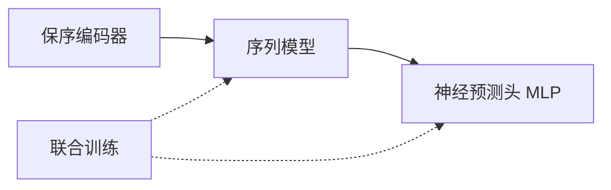
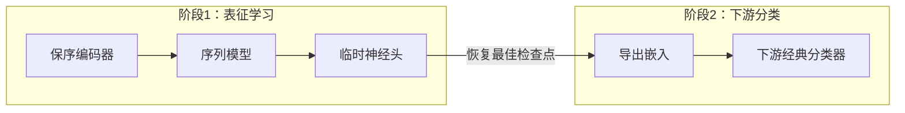

# 训练模式

训练模式（Training Mode）决定[序列模型](./sequence-models)路径（及 Pair 任务路径）中序列模型与预测头的组织方式。平台支持两种训练模式，通过 `--training_mode` 参数选择。

## 模式一览

| 模式 | 说明 |
| --- | --- |
| `end_to_end` | 端到端预测：序列模型与神经预测头一起训练 |
| `export_embeddings` | 导出嵌入：序列模型以临时头训练后导出嵌入，再训练下游经典分类器 |

模式与末端分类器的组合是固定契约：`end_to_end` 使用 `MLP` 预测头；
`export_embeddings` 必须使用 SVM、随机森林、ExtraTrees、HistGB、XGBoost、
LightGBM 或 Logistic Regression 等经典下游分类器。

这些路线中的预训练编码器保持冻结。此处共同训练指受支持的适配器、序列或交互模型与预测头，不表示微调预训练骨干。

## end_to_end — 端到端预测

序列模型与神经预测头（MLP）联合训练，梯度从预测头回传至序列模型。

::: tip 适用场景
- 数据量充足，希望序列模型与预测头协同优化。
- 希望共同训练受支持的任务模型与预测头。
- 旧版 `--model cnn|rnn|gru|lstm|transformer` 的默认映射即为此模式（`classifier=mlp`）。
:::

## export_embeddings — 导出嵌入

分两阶段完成：

1. **表征学习阶段**：序列模型以临时神经头训练，学习有用的序列表征。
2. **下游分类阶段**：恢复最佳检查点，导出嵌入，再训练下游经典[分类器](./classifiers)作为最终预测器。

::: warning 临时头指标是诊断信息
临时头指标用于监控表征学习的质量，**并非最终模型结果**。最终模型结果应以阶段 2 下游分类器的指标为准。
:::

### 适用场景

- 希望用经典分类器（SVM、随机森林、XGBoost 等）替代神经预测头。
- 想要获得可复用的序列嵌入，用于后续多种下游任务。
- 希望在相同导出表示上比较下游分类器；效果取决于数据与评估协议。

## 引导流程中的位置

序列模型路径的引导流程中，训练模式是第 5 步：

1. `Choose feature extraction`
2. `Choose tokenizer`
3. `Choose encoder`
4. `Choose sequence model`
5. **`Choose training mode`**
6. 若导出嵌入，`Choose downstream classifier`

## Pair 任务的训练模式

Pair 任务采用相同的两阶段约定：

- **single_stream**：拼接后的序列以序列模型建模，可选 end_to_end 或 export_embeddings。
- **two_stream + token 级交互**：交互编码器（cross_attn / bi_cross_attn）在 `end_to_end` 下与神经头共同训练；在 `export_embeddings` 下先用临时头训练，再导出互作嵌入并训练经典分类器。

详见 [Pair 互作](./pair-interaction)。

## 兼容性

::: info 旧版命令映射
旧版 `--model cnn|rnn|gru|lstm|transformer` 命令映射为 `sequence_model=<model>`、`training_mode=end_to_end`、`classifier=mlp`。新写法推荐使用 `--sequence_model`、`--training_mode`、`--classifier` 三个角色级参数以暴露更清晰的模型结构。
:::

## 相关页面

- [序列模型](./sequence-models) — 序列模型与预测头的衔接
- [分类器](./classifiers) — 下游经典分类器与自动调参
- [Pair 互作](./pair-interaction) — Pair 任务的导出嵌入约定

## 选择目标与表征复用

检查点、阈值和调参目标见[模型选择目标](../concepts/selection-objectives)。失败 SVM 的已有表征复用属于独立的[下游续训流程](../web-ui/versions-and-resume)，不是第三种训练模式。
